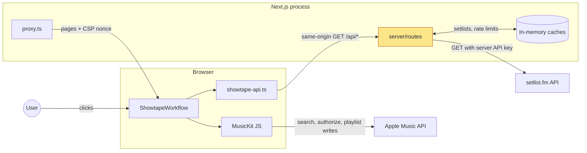
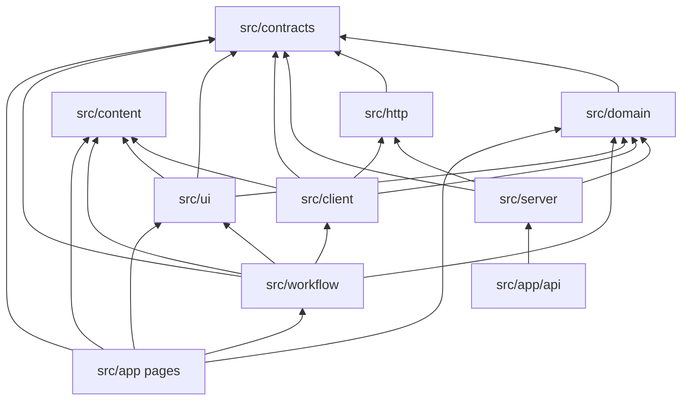
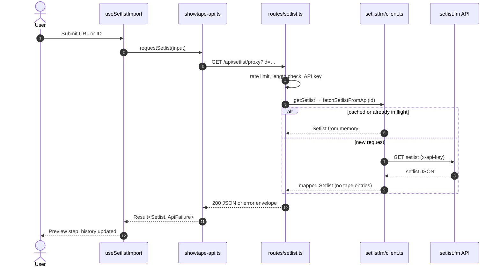
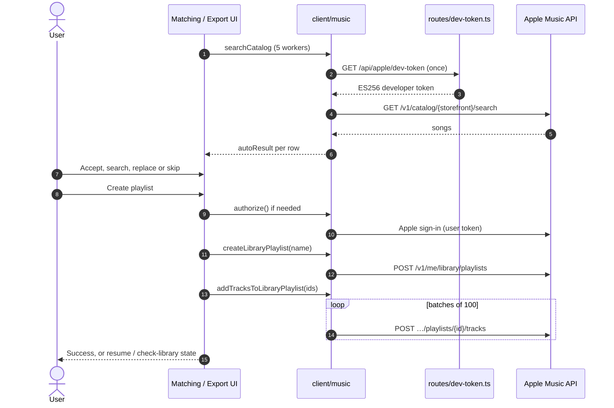
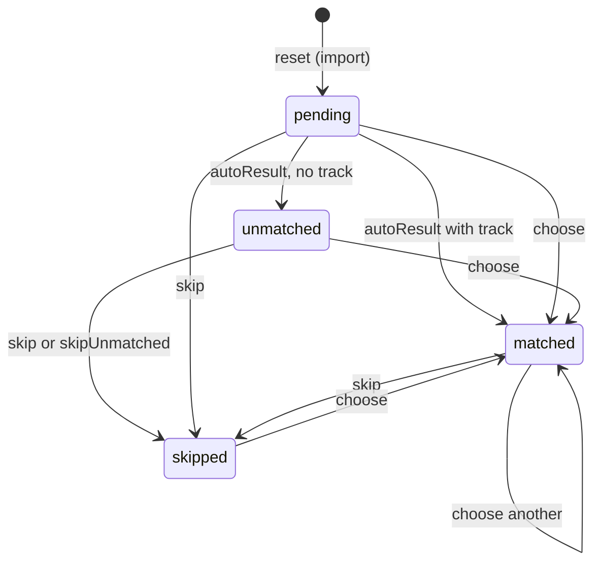
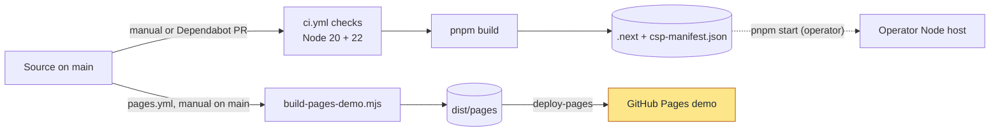

# Architecture

## How it fits together

Showtape is one root Next.js application. A single Node.js process serves the
browser interface and three API Route Handlers — there is no separate API
service, database, or queue.

The browser uses Showtape's same-origin API for two things: importing a setlist
and signing an Apple developer token. Everything else Apple-related — catalog
search, user authorization, and playlist writes — goes straight from the
browser to Apple Music. The static demo is built from allowlisted local files
and deliberately has no network or storage access.

This container view answers "what runs where, and who talks to whom":

`proxy.ts` runs in front of every page request and adds the security headers;
API paths are excluded from it. `server/routes` is the only code that holds a
secret, and the browser reaches it only through `showtape-api.ts`. MusicKit is
loaded from Apple's CDN (`js-cdn.music.apple.com/musickit/v3`) and talks to
Apple directly, so the Next.js process never sees Apple user data.

Where in the code:

- [src/proxy.ts](../src/proxy.ts) — page headers and CSP nonce
- [src/workflow/ShowtapeWorkflow.tsx](../src/workflow/ShowtapeWorkflow.tsx) — the browser app root
- [src/client/showtape-api.ts](../src/client/showtape-api.ts) — the only caller of `/api/*`
- [src/server/routes](../src/server/routes) — one module per endpoint
- [src/client/music/client.ts](../src/client/music/client.ts) — MusicKit loading and configuration

## Repository boundaries

The web app is a single private pnpm package; its dependency overrides live in
`package.json` under `pnpm.overrides`.

| Path            | Responsibility                                                                    |
| --------------- | --------------------------------------------------------------------------------- |
| `src/app`       | App Router pages, layouts and error states; `app/api/**/route.ts` only re-export. |
| `src/contracts` | Shapes shared by server and browser: API error envelope, codes, `Result`.         |
| `src/domain`    | Pure setlist parsing, input rules, entities, naming, signatures, and matching.    |
| `src/http`      | Runtime-neutral bounded Fetch body reading.                                       |
| `src/server`    | Endpoint behavior, env config, HTTP policy, token signing, setlist.fm access.     |
| `src/client`    | `showtape-api.ts` (same-origin Showtape API) and `music/` (browser MusicKit).     |
| `src/workflow`  | The journey (`journey.tsx`) and its stages: `import/`, `matching/`, `playlist/`.  |
| `src/ui`        | Generic controls and presentation reused by app pages and the workflow.           |
| `src/content`   | Product, legal, and attribution copy rendered by the application.                 |
| `src/proxy.ts`  | Page security headers and the per-request content-security-policy nonce.          |
| `tests`         | Contracts grouped by application boundary.                                        |
| `demo`          | Source for the simulated static workflow.                                         |
| `scripts`       | Architecture, public-boundary, and static-demo checks.                            |

`scripts/check-architecture.mjs` is the authoritative dependency contract. It
parses source imports, enforces the allowed layer directions and external
dependency allowlists, and rejects cycles. Higher layers may depend only on the
lower-level boundaries shown here:

`src/contracts` and `src/domain` stay framework-free. Concrete I/O stays in
`src/server` or `src/client`, and App Router files stay as composition points.

### Inside the server and the workflow

- `src/server/routes/<endpoint>.ts` owns one endpoint's complete
  request-to-response behavior: rate limiting, input checks, configuration
  lookup, the single mapping to HTTP status and envelope, and headers. Shared
  HTTP policy lives in `src/server/http`; `src/server/config.ts` is the only
  server module that reads the environment (lazily, per call), apart from the
  self-contained CSP code in `src/server/security`. Pure service seams sit
  beside their integration: `apple-token/developer-token.ts` and
  `setlistfm/get-setlist.ts`.
- Each workflow stage has one state owner: `import/useSetlistImport.ts`,
  `matching/useAutoMatch.ts` (rows in `matchesReducer`, `matching/model.ts`)
  with `matching/useTrackSearch.ts`, and `playlist/usePlaylistExport.ts`.
  `journey.tsx` defines the four steps once and owns the current step and
  focus movement. It also keeps a copy of the match rows (the draft), synced
  from the lazily loaded matching stage, so Back and forward navigation keep
  the user's choices; importing a setlist clears it, and a draft saved
  mid-run resumes searching its pending rows. Hooks receive semantic
  callbacks, never another component's state setters.
- `MatchingStep` and `ExportStep` render their headers eagerly and load
  `MatchingWorkflow` and `PlaylistExportWorkflow` lazily, so first-load code
  for `/` contains no MusicKit or catalog code. Apart from those two step
  shells, eager files (`ShowtapeWorkflow`, `journey.tsx`, `import/`) import
  from `matching/` and `playlist/` only with `import type`. This is a
  convention.

New code goes where its responsibility already lives: a new endpoint is a
`src/server/routes` module plus a one-line `route.ts`, and its path must be
added to the exclusion in the `src/proxy.ts` matcher (API routes don't get the
document CSP); a new stage concern goes
in that stage's folder; only genuinely generic presentation goes in `src/ui`.

## Runtime flows

### Importing a setlist

What happens when the user pastes a setlist.fm URL and presses Load:

Step 4 can end early with a 429 or 400 before any upstream work. In steps 5–9,
`get-setlist.ts` parses the ID and maps upstream status codes to API error
codes (a rejected server key becomes a 503, not the user's fault). Step 12 also
pushes the input onto the recent-imports list in `localStorage`.

Where in the code:

- [src/workflow/import/useSetlistImport.ts](../src/workflow/import/useSetlistImport.ts) — submit, abort, history
- [src/server/routes/setlist.ts](../src/server/routes/setlist.ts) — HTTP policy and status mapping
- [src/server/setlistfm/get-setlist.ts](../src/server/setlistfm/get-setlist.ts) — ID parsing, error codes
- [src/server/setlistfm/client.ts](../src/server/setlistfm/client.ts) — cache, admission, retries, fetch
- [src/server/setlistfm/map-response.ts](../src/server/setlistfm/map-response.ts) — upstream JSON → `Setlist`

Details of the upstream call: the client rejects redirects, bounds the
response body, and checks the required fields and that the returned ID is the
one requested. The browser receives only the mapped shape, with the validated
attribution URL kept visible.

The upstream request has a 10-second total deadline and at most two bounded
retries for HTTP 429. Successful responses are cached in a per-process,
200-entry fixed-TTL LRU cache for one hour when their serialized mapped form is
at most 500,000 characters. Identical in-flight IDs share a single request.
After those fast paths, each process admits at most 32 distinct upstream
operations concurrently and 120 new operations per minute. Retries remain part
of one admitted operation; excess work receives HTTP 429 with `Retry-After`.

### Matching and playlist export

What happens from the Match step to a created playlist:

Steps 2–3 happen once per 55 minutes: `token.ts` caches the token and
`initMusicKit` configures MusicKit with it. Steps 1–6 repeat for every row,
with five searches in flight and results cached in memory for five minutes
(up to 500 entries). Steps 8–15 run in `usePlaylistExport`, which allows only
one mutation at a time. If a batch in step 14 fails with a definite error, the remaining IDs go to
`sessionStorage` for a resume; if the outcome is unknown, the user is told to
check their library instead.

Each match row moves through these states (`matchesReducer`):

An `autoResult` only changes a row that is still `pending`, which is why a
manual choice made while a search is running is never overwritten. Only
`matched` rows contribute track IDs to the export.

Where in the code:

- [src/workflow/matching/useAutoMatch.ts](../src/workflow/matching/useAutoMatch.ts) — the five search workers
- [src/workflow/matching/model.ts](../src/workflow/matching/model.ts) — `MatchRow` and `matchesReducer`
- [src/client/music/catalog.ts](../src/client/music/catalog.ts) — storefront search and cache
- [src/client/music/token.ts](../src/client/music/token.ts) — developer-token cache
- [src/server/routes/dev-token.ts](../src/server/routes/dev-token.ts) and [src/server/apple-token](../src/server/apple-token) — token signing
- [src/workflow/playlist/usePlaylistExport.ts](../src/workflow/playlist/usePlaylistExport.ts) — create, add, resume
- [src/client/music/playlist.ts](../src/client/music/playlist.ts) — library writes in batches of 100
- [src/workflow/playlist/resume.ts](../src/workflow/playlist/resume.ts) — 30-minute partial-export record

The MusicKit user token, playlist name, selected IDs, and Apple API responses
never pass through Showtape's API routes. A definite add-tracks failure can keep
the exact remaining IDs for a resume. A transport failure has an unknown
outcome, so the user has to check their Apple Music library before trying again.

## HTTP surface

| Route                       | Purpose                                                     | Important response policy                                                                                    |
| --------------------------- | ----------------------------------------------------------- | ------------------------------------------------------------------------------------------------------------ |
| `GET /api/health`           | Report process liveness and a timestamp.                    | Does not test either external service.                                                                       |
| `GET /api/apple/dev-token`  | Sign an Apple developer token from server credentials.      | No-store; 30 requests per 60 seconds when trusted-proxy limiting is active.                                  |
| `GET /api/setlist/proxy`    | Parse an `id` or `url` query and return the mapped setlist. | Success is private-cacheable for one hour; 20 requests per 60 seconds when trusted-proxy limiting is active. |
| `OPTIONS` on each API route | Return CORS preflight policy.                               | HTTP 204 with no body.                                                                                       |

Errors carry an `error` string and, usually, a stable `code`: `BAD_REQUEST`,
`NOT_FOUND`, `RATE_LIMIT`, `INTERNAL`, or `SERVICE_UNAVAILABLE`. The one
exception is a missing `id` or `url`, whose response has no `code`.

`ALLOWED_ORIGIN` lists the exact allowed origins. When it is unset, only
plain-HTTP `localhost` and `127.0.0.1` origins are allowed; wildcard and `null`
origins are rejected. Per-client rate limiting stays off unless `TRUST_PROXY=1`
and a trusted forwarded client address is available. The process-wide setlist.fm
admission policy is independent of this per-client setting.

## State ownership and failure boundaries

| State                                         | Owner                    | Lifetime                                 |
| --------------------------------------------- | ------------------------ | ---------------------------------------- |
| Imported setlist and match choices            | React workflow state     | Current page session                     |
| Up to eight recent inputs and parsed IDs      | Browser `localStorage`   | Until browser storage is cleared         |
| Known partial playlist progress               | Browser `sessionStorage` | At most 30 minutes                       |
| Setlist response cache and in-flight requests | Next.js process memory   | At most one hour or until restart        |
| Rate-limit buckets                            | Next.js process memory   | Fixed window or until restart            |
| MusicKit developer token and catalog cache    | Browser memory           | 55 minutes and five minutes respectively |

Multiple server processes do not share caches or limiter state. There is no
durable application state, migration system, backup format, background retry, or
cross-instance coordination.

## Security boundaries

- `APPLE_TEAM_ID`, `APPLE_KEY_ID`, `APPLE_PRIVATE_KEY`, and `SETLISTFM_API_KEY`
  stay in the server environment.
- `NEXT_PUBLIC_APPLE_MUSIC_APP_ID` is browser-visible and baked in at build time.
- API responses apply exact-origin CORS, content-type protection, and frame
  denial. `src/proxy.ts` applies page CSP, HSTS, referrer, permissions, and
  related browser headers.
- `TRUST_PROXY=1` is safe only when the reverse proxy strips client-supplied
  forwarded-IP headers and writes trusted values.
- Response readers on both sides reject bodies larger than 10 MiB.

Reporting policy and operator responsibilities live in [SECURITY.md](../SECURITY.md).

## Build and delivery boundaries

How a change is checked and what gets published:

`ci.yml` runs only when triggered by hand or for a Dependabot pull request; it
runs audit, hygiene, format, lint, architecture, typecheck, build and the demo
contract. `pnpm build` runs `next build` and then
`scripts/generate-csp-manifest.mjs`, which writes `.next/csp-manifest.json`.
The dotted edge is not automated: no workflow deploys the live app, and the
host is whatever the operator runs (see [DEPLOYMENT.md](DEPLOYMENT.md)).

The root package builds the web application. `next build` produces the live
application artifact, while `scripts/build-pages-demo.mjs` produces the
separate, ignored `dist/pages` artifact. The demo builder permits exactly the three files under `demo`, the
shared global stylesheet, the Showtape mark, and `.nojekyll`; it rejects network, navigation,
persistent-storage, and MusicKit APIs.

The repository has CI and a Pages workflow for the static demo, but no
live-application deployment workflow, container,
process supervisor, reverse-proxy configuration, or rollback automation. See
[deployment and configuration](DEPLOYMENT.md).

Static web HTML is paired with an immutable script-hash manifest and a fresh
response nonce. The startup and runtime verifier fails closed if the artifact is
incomplete. See [deployment](DEPLOYMENT.md) for the hybrid policy and the checks
required on every upgrade.

## Invariants and non-goals

- Browser calls to Showtape always use same-origin `/api` paths.
- Apple and setlist.fm credentials never enter browser application state.
- The browser MusicKit user token stays in the browser.
- Setlist order and explicit user corrections are preserved.
- The static demo is simulated and is not live-integration evidence.
- A separately deployed API, multiple-setlist workflow, non-Apple export,
  offline mode, and background synchronization are not implemented.

The reasoning behind the application shape is recorded in
[ADR 0001](adr/0001-stack-nextjs-musickit.md).
